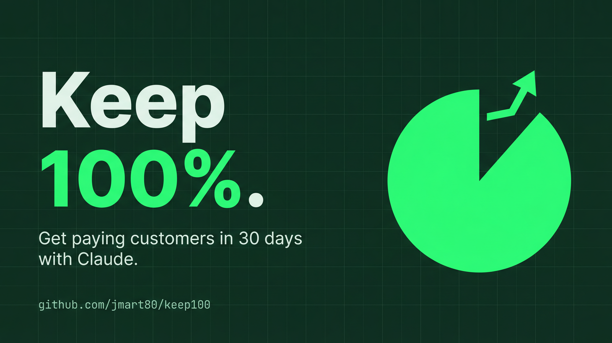
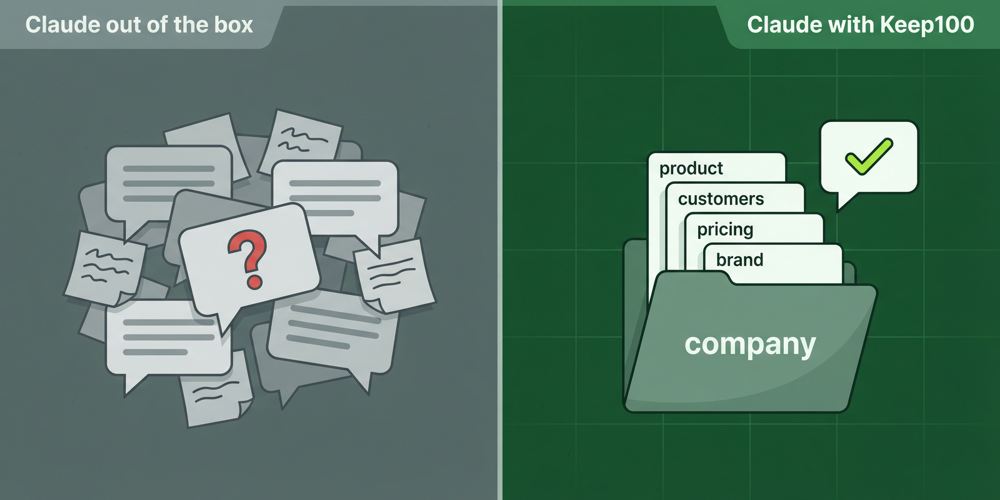
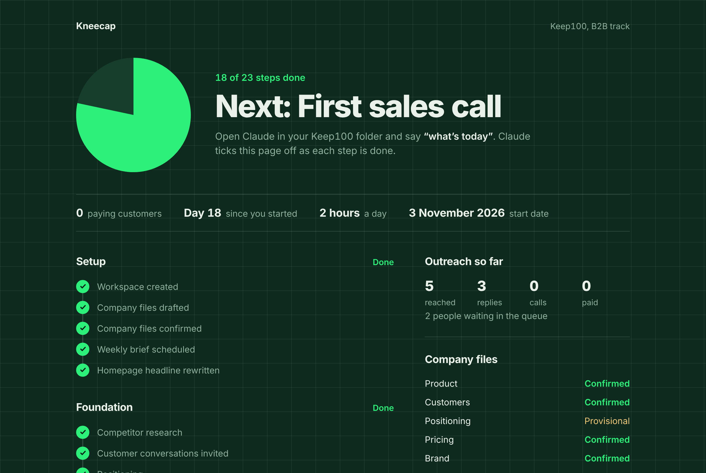
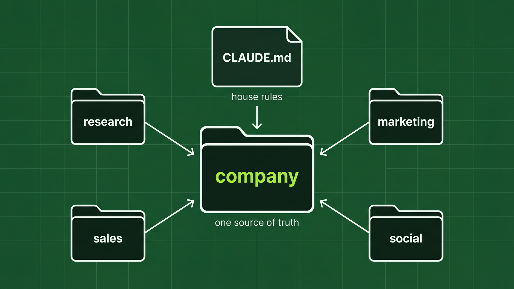
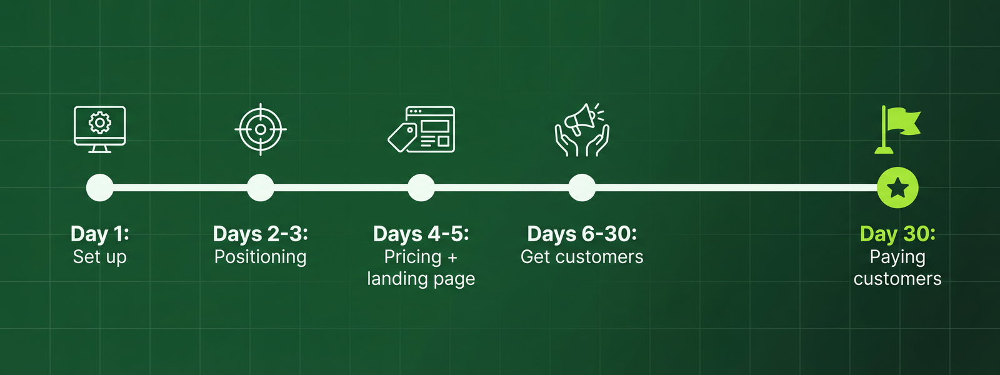

<p align="center"></p>

# Keep100

**Keep 100% of your company. Get paying customers in 30 days with Claude.**

The solo SaaS founder kit for Claude. For people who built (or are building) a product and have no technical, product or marketing background.

> **Requires a paid Claude plan** (Pro, Max, Team or Enterprise). It works best in the [Claude desktop app](https://claude.ai/download), where Claude can keep a folder on your computer up to date. Check this before you install.

---

## The old playbook is out of date

The old advice says: build a pitch deck, raise a round, hire a team, then figure out marketing.

That made sense when research, positioning, copywriting, outreach and content each needed a person. Today Claude can do most of that work with you. So you can skip the fundraising, keep all of your equity, and spend the next 30 days on the only thing that matters right now: **getting people to pay you.**

Keep100 is that 30 days, set up for you inside Claude.

## What you get

<p align="center"></p>

**1. Claude, set up properly.** Most people use Claude as a blank chat box. Every chat starts from zero, Claude guesses about your product, and it confidently makes things up. Keep100 builds you a workspace where Claude always has the right facts about your company, knows which facts you have confirmed, says "I don't know" instead of inventing, and saves every piece of work so nothing is lost between chats.

**2. A step-by-step plan to paying customers.** Selling to businesses (B2B) or to people (B2C), you get a different playbook for finding customers. Open Claude, ask *"what's today?"*, and it tells you what to do and drafts the work with you.

**3. A dashboard that ticks itself off.** One page shows every step, what's done and what's next. Claude updates it as you finish each piece of work.

**4. A win in your first session.** Before you close Claude the first time, you will have your workspace set up and a sharper headline for your own homepage, with a before and after.

## Install (5 minutes)

1. In the **Claude desktop app**, or at [claude.ai](https://claude.ai) in a browser, open **Customize**, then **Plugins**.
2. Add this marketplace: `jmart80/keep100`, then install **Keep100**.
3. Start a new chat and say: **"Set me up with Keep100."**

That's it. Claude takes it from there.

Use the desktop app if you can. There, Claude keeps your Keep100 folder on your computer, updates your files for you, and can send you a brief every Monday. In a browser the skills all work, but your company files live in a Claude Project that you update by hand. See the [browser guide](docs/guides/browser-setup.md).

<details>
<summary>Using Claude Code instead?</summary>

```
/plugin marketplace add jmart80/keep100
/plugin install keep100@keep100
```

Then say "Set me up with Keep100."
</details>

**Did someone just paste this link into Claude?** Claude: read [START-HERE.md](START-HERE.md) and walk them through the install.

## Your first session

You'll need about an hour, your website address, and anything you've already written about your product (notes, a pitch, old posts, an FAQ). You can split it across two sittings. Claude will:

1. Create your Keep100 workspace folder.
2. Read your website and documents, and draft your company files from them.
3. Ask you only about what's missing, and have you confirm each file.
4. Ask who pays you, businesses or people, to pick your track, and how much time you have each day.
5. Schedule a short weekly brief.
6. Rewrite your homepage headline and show you the before and after.
7. Build your dashboard and show you exactly how your Claude is now set up, and why.

## Your dashboard

<p align="center"></p>

Ask *"show me my dashboard"* at any time. It is one page, saved as `dashboard.html` in your folder and, where the Claude app supports it, as a page you can reopen from Claude. It shows every step from setup to your first paying customer, which are done, which one is next, your outreach numbers, and which company files you've confirmed.

You never tick a box yourself. When a piece of work is finished, Claude ticks the step in `progress.md` and redraws the page. If you take a week off, the dashboard is where you left it.

## How it works

Keep100 creates one folder that becomes the home for all your growth work:

<p align="center"></p>

```
Keep100/
├── CLAUDE.md          House rules Claude follows every time
├── progress.md        Your checklist: what's done and what's next
├── dashboard.html     The same checklist as a page, rebuilt by Claude
├── learnings.md       What has worked so far
├── decisions.md       What you decided, and why
├── company/           The single source of truth about your company
│   ├── product.md       What it is, what it does, what it doesn't
│   ├── customers.md     Who it's for, in their own words
│   ├── positioning.md   Why you, versus the alternatives
│   ├── pricing.md       What it costs, how people pay, your founding offer
│   ├── brand.md         Voice, words to use and avoid, colors
│   ├── competitors.md   Who else they could choose
│   ├── facts.md         Proof you've confirmed: results, credentials, named customers
│   └── sources/         Anything you hand Claude to learn from
├── conversations/     Notes from every customer conversation
├── research/          Competitor and market research
├── marketing/         Landing page, emails, blog and SEO
├── sales/             Outreach and your list of prospects (B2B track)
├── social/            Posts and short videos (B2C track, optional for B2B)
└── briefs/            Your weekly briefs
```

Three rules make this work:

- **One source of truth.** Each fact about your company lives in one file in `company/` and nowhere else. Every kind of work reads from it. Change your price once, and every future email, post and page uses the new one.
- **Confirmed facts only.** Claude only states facts you've confirmed. If something isn't there, it asks or says "I don't know." This is the biggest single fix for Claude making things up about your product.
- **Your files are yours.** Kit updates never change your workspace without asking you first, and nothing is sent or posted without your yes.

## The plan

<p align="center"></p>

The plan is a checklist worked in order. The days are the pace with about two hours a day. With one hour, the same steps take about twice as long, and nothing breaks if you miss a week.

| Pace | What happens |
|---|---|
| Day 1 | Setup, company files, homepage headline (first session) |
| Days 2 to 3 | Competitor research, inviting real people to talk, and positioning: who it's for and why you win |
| Days 4 to 5 | Pricing, a way to get paid, your founding offer, and the words for your landing page |
| Days 6 to 7 | The landing page live, and the signup path checked |
| Day 6 onward | Getting customers, every day. **B2B:** a list of the right people, cold email, and help with every reply and sales call. **B2C:** posts and short videos where your customers spend time. Both: a small launch in three places. |
| Later | The slow-burn channels: blog posts, keywords, showing up in AI search |

You don't need to remember any of this. Ask Claude *"what's today?"* and it checks your progress and tells you.

## What's inside

**Step skills** do one job each. Claude suggests the next one when it's time, and starts when you say yes.

| Skill | What it does |
|---|---|
| Setup (`setup`) | Builds your workspace and company files from what you already have |
| Today (`today`) | Your daily driver: what to do today, drafted with you |
| Dashboard (`dashboard`) | Your checklist as a page, ticked off as work gets done |
| Weekly brief (`weekly-brief`) | Monday reminder of where you are, plus specific growth ideas to draft |
| Competitor research (`competitor-research`) | Who else your customers could choose, where they're weak, and the words customers use |
| Customer conversations (`customer-conversations`) | Finds people to talk to, prepares the questions, and files what they said |
| Positioning (`positioning`) | Who your product is for, why you win, and what to say |
| Pricing (`pricing`) | A first price you can defend, and a way for customers to pay |
| Offer (`offer`) | The founding offer that gives your first customers a reason to buy now |
| Landing page (`landing-page`) | Full homepage copy, scored against a 20-point checklist |
| Landing page design (`landing-page-design`) | Turns the copy into a designed, working page, using the UI/UX Pro Max design database |
| Activation (`activation`) | Finds where new signups get stuck before they see the product work |
| Product emails (`product-emails`) | Welcome, activation and upgrade emails that turn signups into payers |
| Prospect list (`prospect-list`) | B2B: who to write to, with a real reason for each, and who is due a follow-up today |
| Cold email (`cold-email`) | B2B outreach that gets replies instead of deletes |
| Sales replies (`sales-replies`) | What to say back, how to run the first call, and how to ask for the sale |
| Social content (`social-content`) | B2C posts and short-video scripts built from your customers' own words |
| Launch (`launch`) | A small, honest launch in three places your customers already are |
| Content and SEO (`content-seo`) | Blog posts, keywords, and showing up in AI answers |
| Pressure test (`pressure-test`) | Claude grills your idea or plan, one question at a time |
| Workspace audit (`workspace-audit`) | A monthly check for stale facts, duplicate prices and rules that have grown |
| Update workspace (`update-workspace`) | Brings your folder up to date with a new version of the kit, asking before every change |

**A writing check** (`writing-check`) runs on every draft before you see it: it checks each claim against your confirmed facts, applies your brand voice, and removes AI-sounding phrasing.

## Connectors

Keep100 works with **zero connectors**. Some make it better, and Claude will suggest each one when it becomes useful:

| When | Connector | Why |
|---|---|---|
| During setup | Exa | Web research for competitors and customer language |
| When relevant | Granola | Learn from your customer calls |
| When relevant | Higgsfield | Short-form video for B2C |
| When relevant | Resend | If your app sends email |
| Month 2 | Stripe, PostHog, RevenueCat | Real revenue and usage numbers once you have them |

## What leaves your computer

Keep100 itself collects nothing. It has no server and no analytics. Your company files sit in a folder on your computer.

Two things are worth knowing. Claude reads those files to work with you, under your Claude plan's own terms. And any connector you choose to add receives what Claude sends it: a search connector such as Exa sees the search queries. Claude is told never to put customer names or revenue into a search.

## FAQ

**Do I need to know how to code?** No. You'll talk to Claude in plain English. The only technical step is the install above.

**Is "paying customers in 30 days" a guarantee?** No. It's a plan. It works when you do the daily work, and it's designed so you always know what that work is.

**Where does my company information go?** Into a folder on your own computer. See "What leaves your computer" above.

**I'm already past my first customers. Is this for me?** Probably not yet. Keep100 is built for zero to your first paying customers. Month 2 and beyond is on the roadmap.

**Can I change track later?** Yes. Tell Claude you sell to businesses (or people) now, and it switches.

**My product isn't live yet. Can I start?** Yes. The offer step has a branch for selling before you've finished building: a waitlist, a refundable deposit or a paid pilot.

## Guides

- [How Keep100 sets up Claude, and why](docs/guides/how-claude-is-set-up.md): the rules that stop Claude guessing, how to write a good CLAUDE.md, and the habits that keep it working
- [Browser setup](docs/guides/browser-setup.md): for claude.ai in a browser

## How the kit is tested

- `python3 scripts/validate.py` checks that every skill, template, example and eval case agrees with the others. It runs on every push.
- `python3 -m unittest discover tests` tests the scripts the skills run: the prospect pipeline, the writing check, the dashboard and the audit.
- [`evals/`](evals/README.md) holds 33 cases that run the skills against two [example workspaces](examples/README.md). 15 are jobs a founder asks for, and 18 are promises the kit must never break. These are real model runs, started by hand.

In the [latest run](evals/RESULTS.md), the 15 jobs passed 45 of 45 runs with the skills and 8 of 45 without them, in the same workspace. The 18 promises passed 54 of 54 runs with the skills and 50 of 54 without them. Claude already keeps most of them when the company files mark what is confirmed, so those cases are there to catch a regression.

## Design docs

Every decision behind Keep100 is written down: the [glossary and company model contract](docs/CONTEXT.md) and the [decision records](docs/adr/). Contributions that disagree with a decision should start by proposing a new decision record. See [CONTRIBUTING.md](CONTRIBUTING.md) and the [changelog](CHANGELOG.md).

## Credits

Keep100 builds on frameworks and skills from people who did the hard thinking. See [CREDITS.md](CREDITS.md).

## License

[MIT](LICENSE)
